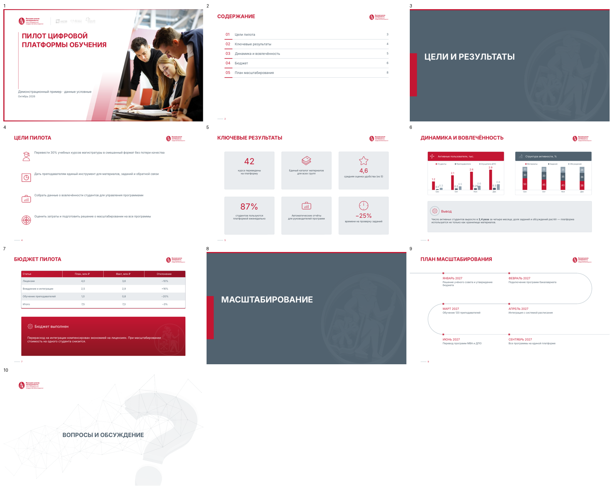

# gsom-design — презентации в стиле ВШМ СПбГУ для Claude

Плагин для Claude Code со скиллом **`gsom-presentation`**. Достаточно написать
**«Создай презентацию в стиле ВШМ про …»**, и Claude соберёт `.pptx` по брендбуку
Высшей школы менеджмента СПбГУ.

Как это работает: скилл не рисует слайды с нуля, а собирает их из **официального шаблона
презентации ВШМ** (110 образцовых слайдов: титулы, разделители, карточки, таблицы, диаграммы,
схемы, таймлайны, контакты, библиотеки иконок, иллюстраций и фото). Claude выбирает подходящие
слайды, заполняет их текстом, данными и фото, затем рендерит превью и проверяет результат.



## Установка

### Вариант 1 — плагин Claude Code (рекомендуется)
```
/plugin marketplace add ardubrovskij-dotcom/gsom-design
/plugin install gsom-design@gsom-design
```

### Вариант 2 — открыть этот репозиторий
```bash
git clone https://github.com/ardubrovskij-dotcom/gsom-design.git
cd gsom-design && claude
```
Скилл подключён как проектный: `.claude/skills/gsom-presentation` — это ссылка на `skills/gsom-presentation`.

### Вариант 3 — личный скилл
Скопируйте папку `skills/gsom-presentation` в `~/.claude/skills/`.

### Вариант 4 — claude.ai
Заархивируйте папку `skills/gsom-presentation` (`zip -r gsom-presentation.zip skills/gsom-presentation`)
и загрузите архив в настройках claude.ai → Capabilities → Skills. Архив весит около 40 МБ,
лимит загрузки проверьте в настройках: нет подтверждённых данных о текущем лимите.

### Зависимости
- Python 3.9+, `pip install python-pptx pillow lxml`
- Для предпросмотра слайдов: LibreOffice (`soffice`) и poppler (`pdftoppm`).
  Без них презентация собирается, но Claude не сможет проверить её визуально.

## Примеры запросов
- «Создай презентацию в стиле ВШМ: итоги приёмной кампании 2026, данные в приложенной таблице»
- «Сделай 10 слайдов для дня открытых дверей магистратуры ВШМ»
- «Переоформи эту презентацию в фирменный стиль ВШМ» (с приложенным файлом)
- «Make a GSOM-style deck in English about our Executive MBA partnership»

## Что внутри

```
skills/gsom-presentation/
  SKILL.md                  # инструкция для Claude: порядок работы и правила
  reference/brandbook.md    # выжимка брендбука: цвета, шрифт, логотип, элементы, фото
  reference/catalog.md      # каталог из 110 слайдов шаблона
  reference/spec.md         # формат описания презентации (spec.json)
  scripts/gsom_deck.py      # движок: list / fields / build / render / check
  scripts/catalog.py        # ключи и описания слайдов
  assets/template.pptx      # официальный шаблон ВШМ (подготовленный, см. ниже)
  assets/catalog/*.jpg      # превью слайдов с номерами редактируемых фигур
  assets/logos/             # все версии логотипа RU/EN (svg + png)
  assets/elements/          # фирменный паттерн и контейнеры для фото (svg)
  assets/fonts/             # Inter (SIL OFL 1.1)
tools/
  build_templates.py        # исходный шаблон из брендбука -> assets/template.pptx
  build_catalog.py          # превью каталога и reference/catalog.md
examples/demo/              # пример spec.json, готовой .pptx и превью
```

Ручная сборка без Claude:
```bash
S=skills/gsom-presentation/scripts
python3 $S/gsom_deck.py list                       # каталог слайдов
python3 $S/gsom_deck.py fields cards-3             # поля слайда
python3 $S/gsom_deck.py build examples/demo/spec.json demo.pptx
python3 $S/gsom_deck.py render demo.pptx preview/  # PNG-превью
```

## Источник и отличия от исходного шаблона

Материалы взяты из папки «Брендбук ВШМ СПбГУ» на Google Drive: `00_Brandbook_GSOM_SPbU.pdf`,
«Шаблон презентации рус.pptx», логотипы, шрифт, паттерн, контейнеры.
`tools/build_templates.py` готовит шаблон так:

| Что | Было в шаблоне | Стало | Основание |
|---|---|---|---|
| Красный | `#BE1E2D` в теме | `#C31632` | брендбук, с. 23 |
| Шрифты | Inter, а также Euclid Circular A/B, Roboto и Arial в отдельных фигурах | Inter везде | брендбук, с. 34: Inter — для печати и документов, Euclid — только для сайта |
| Логотипы | svg с цветами `#BE1E2D` / `#51626F` | официальные файлы из папки «Логотип» | брендбук, с. 18–19 |
| Слайды | 129 | 110: убраны служебный слайд «Резюме», 2 пустых слайда, 9 разделителей-оглавлений самого шаблона и 7 слайдов с флагами | — |
| Размер | 50 МБ | 31 МБ: картинки ужаты до 1800 px по длинной стороне | — |

Английская версия собирается из того же шаблона: при `"lang": "en"` логотипы заменяются
на английские из брендбука.

Вопросы по фирменному стилю — GSOMmarketing@gsom.spbu.ru (контакт из брендбука).
